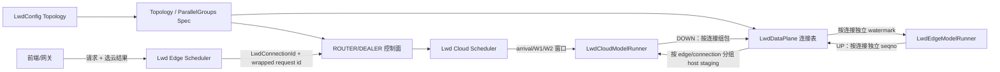

# vLLM / vLLM-Ascend 分支功能差异与多边多云融合方案

> 分析日期：2026-11-01  
> 目标基线：`main_base_br_1101`  
> 功能来源：`23.0_all_base_br_1031`  
> 范围：LWD 边云协同、其 vLLM 控制面/调度面，以及 vLLM-Ascend NPU 数据面与执行适配。普通上游改动不逐项展开。  
> 交付方式：双仓同步实施，全部目标功能纳入同一个迁移变更集，一次性集成、验收和交付，不分阶段上线或分批裁剪范围。  
> 本文仅做静态代码与提交历史分析，不修改产品代码，也不代表已通过 NPU 系统测试。

## 1. 结论摘要

融合应采用“**保留 `main_base_br_1101` 架构，将 `23.0_all_base_br_1031` 的多边多云行为一次性完整迁入**”的方式，不能整目录覆盖，也不建议按旧分支提交顺序批量 cherry-pick。

本次迁移采用单一交付边界：下述工作包只是同一迁移内部的任务拆分和编码依赖，不是可独立交付、上线或延期裁剪的功能阶段。双仓代码必须同步集成，M01～M29 全部完成并通过统一验收后才算迁移完成；静态 2E1C/1E2C 跑通或部分高级能力完成均不能作为完成标准。

完整性目标是：23.0 的多边多云主流程、部署形态、网关/直连、跨边复用、多前端、容错与运维配套均有明确去向；main 已有或已替代的能力以等价实现和回归测试证明保留，而不是简单从迁移清单中删除。

新基线已经发生几项决定迁移方式的架构变化：

- 控制面已由旧 pub/sub `control_communication` 改为 `lwd_comm` ROUTER/DEALER 通信。
- Ascend 数据面已由旧 `lwd_comm` / `lwd_wire` 迁移为 `distributed/lwd_data_plane`，核心类、通道和 future 均已重命名并调整职责。
- 边云并行组建由 LWD 拓扑推导；旧分支借用两段 PP 表达边云关系的实现不能带回。
- 新基线以 UP host staging、累计 arrival、W1/W2 和 native prefill 窗口为云侧接收与调度主线。
- 新基线的配置、Spec、控制面和数据面命名已经按可扩展拓扑设计；多边多云应扩展这些模型及其运行态，不应恢复一套平行的旧 registry/旧通信栈。

因此，真正需要迁移的是旧融合分支中的多实例身份、选云与路由、按云/按引擎分账、跨边生命周期管理、多 DP 数据面扇出、部署形态及相关容错，而不是旧一边一云的代码骨架。

## 2. 分析基线与差异口径

| 仓库 | 分支 | 提交 | 提交时间 |
| --- | --- | --- | --- |
| vllm | `main_base_br_1101` | `a69f91661d71716e11bd0c00d4f2c77ff1ba293b` | 2026-10-31 17:53:02 +0800 |
| vllm | `23.0_all_base_br_1031` | `ba0be1ce3784fe63705fd20593d8a7b95ea3cbdb` | 2026-10-31 19:17:21 +0800 |
| vllm-ascend | `main_base_br_1101` | `0ecb010cf59ab58a1a02ea18691768d8ae7635a1` | 2026-10-31 17:53:32 +0800 |
| vllm-ascend | `23.0_all_base_br_1031` | `a3fa872476e2d731b77f8d91be5e98074e80d0ac` | 2026-10-31 18:49:05 +0800 |

| 仓库 | merge-base | 新基线独有提交 | 23.0 融合基线独有提交 | 两分支直接 diff |
| --- | --- | ---: | ---: | --- |
| vllm | `0fc695fc6d1d82e9a5ac6835ac8e4e1c83703665` | 4116 | 441 | 5109 文件，+210687 / -914857 |
| vllm-ascend | `97b216a6b7155a937d90fb19fbd43a425f30749d` | 1726 | 214 | 3505 文件，+268834 / -657704 |

直接 diff 包含双方分叉后的全部上游演进，不能直接当作功能迁移清单。本文同时使用：

1. `merge-base..23.0_all_base_br_1031`：识别旧融合分支相对共同祖先新增的 LWD 行为。
2. `main_base_br_1101..23.0_all_base_br_1031`：识别当前代码结构与旧实现的实际冲突。
3. 当前新基线源码、设计文档及测试：剔除已经迁移或以新架构重新实现的能力。

按 merge-base 到旧融合分支的口径，vllm 有 97 个文件变化（约 +26810/-158），主要位于 `vllm/v1/lwd_control`、`vllm/v1/lwd_debug` 和 `tests/v1/lwd_control`；vllm-ascend 有 57 个文件变化（约 +10438/-448），主要位于 `distributed/lwd_comm`、`worker/lwd_cloud`、`worker/lwd_hash`、`examples/edge_cloud_*` 和 `tests/ut/worker`。

## 3. 目标架构约束

| 架构层 | `main_base_br_1101` 现状 | 旧分支中不得直接恢复的实现 | 融合原则 |
| --- | --- | --- | --- |
| 配置与拓扑 | `LwdConfig`、拓扑 Config 与运行时 Spec 分工；link/connection 语义明确 | 独立 registry 成为第二套拓扑事实源 | 将多云、多引擎、选云所需信息归一到新配置和派生 Spec |
| 控制面 | `vllm/v1/lwd_control/lwd_comm`，ROUTER/DEALER，统一基类接入 | pub/sub `control_communication`、旧 HELLO/旧接收线程骨架 | 在新消息、注册和路由模型中增加多对端能力 |
| 数据面 | `vllm_ascend/distributed/lwd_data_plane`，`LwdDataPlane` / `LwdTransferQueue` / `LwdTransferFuture` | 旧 `LwdCommService` / `LwdChannel` / `LwdCommFuture` 整层覆盖 | 只迁移通道寻址、扇出和生命周期行为，复用新传输实现 |
| 并行建组 | 从 LWD 拓扑推导共享 world 与各通信组 | 以 pp=2、首/尾 rank 改写表达边云 | 保留新拓扑建组，扩展 `(edge, cloud, engine)` 映射 |
| 云侧接收 | host staging、early-recv hint、累计 arrival、独立 H2D stream | 旧 early-recv 路径及其全局单云状态 | 保留 staging/arrival 顺序，按链路和请求拆分状态 |
| 云侧调度 | native prefill 窗口，W2 约束可见范围 | 旧相位调度器或整文件替换 native scheduler | 在现有调度接缝增加多源请求可见性与公平性 |
| 业务归属 | 控制与业务逻辑在 vllm；NPU 覆写在 vllm-ascend | 将通用选云/调度逻辑下沉到 Ascend | 双仓按职责同步演进，不在 Ascend 建第二控制面 |

## 4. 功能差异与迁移清单

### 4.1 总体能力矩阵

| 能力 | `main_base_br_1101` | `23.0_all_base_br_1031` | 结论 |
| --- | --- | --- | --- |
| 一边一云 UP embeddings / DOWN hidden | 已有，且已重构 | 已有旧实现 | 不迁移旧骨架 |
| 云内多 DP | 已有，以 `dp_idx`/connection 隔离 | 有 engine/DP 适配 | 保留 main 并扩展完整连接身份 |
| Hash MoE、确定性 token rank replay | 已有，含 stable sort 与模块化 router | 已有 | 不重复迁移 |
| MTP/spec decode、多模态、M-RoPE | 已有新接入 | 已有旧接入 | 做回归，不重复迁移 proposer/旧数据流 |
| host staging、early recv、fenced harvest | 已有，是云侧接收主线 | 有旧实现及多边扩展 | 保留 main，只扩展多边状态 |
| abort、云侧 preemption/recompute | 已有新实现 | 有旧实现及多边修复 | 保留 main，补多连接适配 |
| 全 `(edge, cloud, engine)` mesh | 缺失，当前主要是单一边到云内 DP 的映射 | 新增 | **本次必须完整迁移** |
| 请求级选择 cloud/engine | 当前 batch/meta 闭环不足 | 新增 | **本次必须完整迁移，需双仓协同** |
| 每边/每连接 seqno、watermark、MQ 分账 | 不完整 | 新增 | **本次必须完整迁移** |
| 云端点按 edge 在 TP ranks 内轮转 | 缺失，若干部位固定 TP 首 rank | 新增 | **本次必须完整迁移** |
| 多边 early-recv 公平配额 | 缺失 | 新增 | **本次必须完整迁移** |
| wire echo 身份握手和拓扑校验 | 基础 warmup，缺少完整多边校验 | 新增 | **本次必须完整迁移** |
| 网关选云、直连多云 | 不具备完整能力 | 新增 | **本次必须完整迁移** |
| 每边多前端 attach | 只有 API 配置/校验 | 有注册与输出归组实现 | **本次按 main 原生架构完整重做** |
| 跨边云端 prefix/KV 复用 | main 明确禁止 cloud prefix caching | 有完整旧实现 | **本次完整迁移，不能视作已有** |
| 2E1C、2E2I、CLI 多实例模板 | 不完整 | 新增 | 与对应功能同次迁移 |
| 单云故障动态摘除、自愈 | 不具备 | 也未完整支持 | 不作为本次融合的既有能力承诺 |

关键纠偏：main 的 `vllm/v1/lwd_control/control_cloud_scheduler/lwd_cloud_engine.py:73-74` 会对 `enable_prefix_caching` 直接报错。因此旧分支的跨边前缀复用是实际功能缺口，不能因控制消息中已有 hash 字段就认定 main 已支持完整复用。

### 4.2 vllm：配置、控制面与调度面的实际差异

#### A. typed topology 已能描述多边多云，但运行时尚未打通

main 的 `vllm/config/lwd/topology.py` 已有：

- `:150-163`：`LwdDPConnection(edge_id, cloud_id, dp_idx, edge, cloud)`。
- `:165-192`：包含多个 edges/clouds 和 `instance_links` 的 topology。
- `:291-361`：scene、link 约束及连接展开。
- `cloud_share`、`lwd_cluster` 等场景及 full-mesh 表达。

因此不需要恢复 23 的独立 role registry YAML。应复用 main 的 typed topology，把旧 registry 的地址、端口、rank、端点轮转和冲突校验语义并入 Config→Spec 派生。

当前配置的一个明确缺口是 `topology.py:301-321`：coordination 只允许 `cloud_share`，`lwd_cluster` 反而被禁止。`vllm/config/lwd/coordination.py` 也缺少旧分支的 `placement_only`、多值 URL 和 probe 参数。这些是网关工作域需要补齐的配置，不是重建拓扑模型的理由。

#### B. main 控制面更先进，但存在两个硬编码单边限制

应保留 main 的 `vllm/v1/lwd_control/lwd_comm`：ROUTER/DEALER、hello/accept/reject、版本检查、有界发送队列、背压和 per-peer 定向发送均已具备。

需要改造的直接阻塞点：

1. `lwd_control_plane_factory.py:95-102` 要求每个 DP index 恰好一个连接，同一边同 DP 连接多个云会抛出 `NotImplementedError`。endpoint、cloud params、协调 client 和 sender 应从 `dp_idx` 索引改为完整连接键。
2. `lwd_handshake.py:91-127,152-174` 每云 DP 只有一个 `_session`，会拒绝第二个 edge。需改为按 identity/peer 的 session table，同时保持 HELLO 重试幂等、身份防串用和版本校验。

23 的 wire v4 与 main 的消息版本属于不同演进线，不应直接覆盖。身份优先由 peer/连接上下文提供；确需进入消息的字段按 main 的 additive/default 规则追加并提升 `LWD_MESSAGE_VERSION`。

#### C. 云引擎必须把 peer 身份保留到完整请求生命周期

main 的 `control_cloud_scheduler/lwd_cloud_engine.py` 仍存在：

- `:108-116`：单一 `_lwd_edge`。
- `:212-245`：ingest queue 虽保留 `(peer,msg)`，业务 handler 未完整接收 peer。
- `:247-310`：Range、seqno、prompt length 等使用全局字典。
- `:312-339`：Request/Abort 使用原始 request ID。
- `:505-512`：C2E 统一发给单一 edge。

这会导致跨边 request ID/seqno 冲突、abort 错杀、arrival/retire 串域和 C2E 错路由。23 的 `lwd_id_adapter.py` 用 `e{edge_id}-{request_id}` 包装内部 ID，并在回边时解包，其语义需要迁移。

建议明确三层身份：

```text
外部 ID：原始 request_id
云内 ID：canonical(edge_id, request_id)，保证原生 Scheduler/KV 键唯一
连接键：(edge_id, cloud_id, dp_idx)
```

云侧 prompt/seqno/arrival/retire/abort/pending C2E 等状态都要命名空间化；输出按 edge 分组、恢复原始 ID，并使用该连接独立的 DOWN seqno。

#### D. main 边调度已有可复用的多账户骨架

`control_edge_scheduler/lwd_edge_scheduler.py:92-105,147-172,211-237,454-501` 已具备请求绑定 DP、按负载评分、每步服务单 engine 和 picker 过滤；`lwd_cloud_dp_account.py:55-127` 已有负载、pending、watermark 和 gate。

迁移应把账户和路由从 `dp_idx` 扩为 `(cloud_id, dp_idx)`，保留“准入后终身绑定”和现有评分/背压，不恢复 23 的实例分桶调度器。无网关配置下可直接在全部连接账户上评分或轮询。

云侧则保留 `control_cloud_scheduler/lwd_cloud_scheduler.py` 的 arrival-driven native 调度、W2 和 abort 清理，只让请求、arrival 与输出元数据携带可回溯的 edge/connection 身份。旧 `lwd_cloud_phase_scheduler.py`、`lwd_cloud_mixed_scheduler.py` 不应带回。

#### E. 网关放置、直连健康与前缀复用同属一个迁移工作域

23 的 `placement_only` 网关负责选 cloud/DP，但不建 HMAC 链、不开 prefix cache。云内 DP 放置需保持两步语义：所有候选先只读 peek，选定唯一赢家后再 reserve；不能让多个 DP 在 probe 时同时 pin 块。

异步 probe 必须遵守：主引擎线程不执行 HTTP、结果只回灌 engine thread、abort/probe 竞争幂等、请求重试用 nonce 隔离旧结果、in-flight 有界。probe fail-open 只表示不用跨边前缀续算，不代表数据面错误也可忽略。

多值 `control_url`/URL map 和 per-cloud 健康冷却必须与网关放置一起迁移。健康摘除仅影响新请求候选，不动态迁移已绑定请求，也不把已有 channel/seqno 重定向到另一云；仍保留 main 的整组启动/故障语义，不宣称动态自愈。

跨边 prefix/KV 复用也纳入同一交付，其关键行为包括：原生块池命中、probe 快照、reservation/pin/TTL、claim/complete、`prefix_hit_tokens` 上限、HMAC gen-chain、校验后发布、MM-ABI 和 usage 结算。需要适配 main 当前 KVCacheManager，并保证块池操作只发生在 engine thread。

#### F. 多前端与模型加载同属本次完整迁移范围

23 的 `entrypoints/openai/lwd/frontend_attach.py` 有多前端注册、listen 校验和 `client_index` 输出归组；main 的 `config/lwd/api.py` 目前只有配置与校验。多前端不是多边数据面的前置条件，应复用 main 原生多 API server/client_index/headless 架构重做。attach 前端只运行 API server、不创建第二套 EngineCore；主命令等待约定数量前端注册后再释放 engine handshake，并保留配置继承/冲突 diff、listen 冲突检查、client_index 唯一性和输出归组。不得恢复旧 scheduler monkey-patch 或旧 REGISTER/GRANT 协议实现，但这些注册屏障与一致性语义必须保留；attach 模式下前端数与云数也不能硬编码为 1:1。

23 还包含两个与多边多云解耦的辅助能力：

- `model_executor/model_loader/lwd_weight_filter.py`：按角色过滤未构建模块的权重；可作为加载优化独立迁移。
- `scripts/lwd/split_lwd_checkpoint.py`：按角色拆分 checkpoint；可按 main 当前 prefill-only 模型结构复核规则后迁移。

main 的边侧零 transformer 层构建已满足 prefill-only，不恢复旧 `head_tail`、任意 layer split 和 PP 角色体系。

#### G. vllm 数据面也有启动期硬限制

`vllm/distributed/lwd/lwd_parallel_groups.py:76-84` 当前拒绝非 single_instance 场景共享 edge ranks，`:112-127` 拒绝同一 endpoint rank 持有多个 connection channel。因此仅修改控制面握手仍无法启动多边数据面。

channel 身份需要从 `(dp_idx, edge_rank, cloud_rank)` 扩展为包含完整 ConnectionId 的映射，并同步修改 rank group 派生、endpoint 查找、worker channel 注册和跨仓 ABI。云可以将不同边请求混合计算，但 DOWN/C2E 必须按边拆分，不能恢复旧的按边交替调度。

#### H. 网关与跨边 prefix 的协议行为必须完整保留

以下不是可选的实现细节，而是迁移后的验收契约；消息类型和代码结构可按 main 重设计，但行为不能丢失：

1. **per-cloud HELLO 语义**：保存并消费 `num_speculative_tokens`、`prefix_use_eagle`、`max_num_batched_tokens`、`max_num_seqs`、`prefix_alignment_tokens/required`、`prefix_hash_block_size`、`engine_index` 和 `coord_stats_addr`。多值直连下不同云可返回不同语义，必须按云保存，不能覆盖成一个全局值。
2. **prefix resume fail-closed**：probe 零命中必须冻结为零命中；正命中必须复用 probe 时 pin 住的 `blocks_by_group` 和完全相同的 token 数。快照丢失或长度不一致应失败，不得重新调用 `find_longest_cache_hit` 导致 EAGLE/MTP 尾块二次回退。
3. **GenChain 全量替换语义**：上报 prompt+已生成 token 的完整满块链，后一条全量替换前一条，使丢包可由后续消息自愈；仅采用 manifest 与云本地 hash 粒度 `ratio == 1` 的链。链到达前须限制本地占位内容被错误登记为缓存。
4. **FinishNotify 收尾**：校验 prompt/completion 计数、完整链长度和 prompt 前缀链；`publish_cache=False` 或校验失败时仍释放 reservation 并结算真实 usage，但不得发布缓存。媒体身份不完整同样禁止发布。
5. **usage 双通道和 SSE 生命周期**：SSE 后台 drain 与 C2E 回边并存；HTTP 200 后即使 probe 已完成也不能立即关流。超时、取消和回显失败也须由 drain 收尾；drain task 保存强引用，同外部 ID 重试不得覆盖/取消旧任务，无真实 usage 不得伪造零值。
6. **网关身份、安全与隐私**：兼容 `X-Mse-Consumer`、由 `VLLM_LWD_CLOUD_API_KEY` 提供的 Bearer API key 和 `model` 渠道选择；敏感 token 不落日志。HTTP 控制请求采用白名单影子体，不携带原始 messages/采样参数，SSE 控制消息设置大小上限；租户 HMAC key 只在边侧持有。
7. **MM-ABI 回显**：多模态 probe 使用协议 v2 和 ABI header，边侧 fail-closed 校验云回显，禁止静默降级 v1；纯文本不携带 MM-ABI，ABI 不匹配不得使用跨边媒体 prefix。
8. **DP probe 异常语义**：超时/失败 DP 不得进入候选，probe 全灭才整体失败；等待线程和 reservation 必须有等价清理机制，不能只保证正常路径。

#### I. 启动、模型和非 LWD 目录中的配套行为也需逐项接管

- 复核 23 的云侧 `skip_tokenizer_init`、`skip_mm_profiling`、`mm_encoder_remote`、multimodal registry 不建本地 encoder、tokenizer-less reasoning 配置。main 若已有等价启动路径则补回归，否则必须迁移行为。
- 复核 23 在 DeepSeek V2、Qwen3.5、Qwen3-VL 中的 component-wise `lwd_skips_module`：云不建 visual tower、边避免重复 final norm、DeepStack 等组件与角色过滤一致。不能只迁权重过滤而漏掉模型构建条件。
- 对 `vllm/v1/engine/{coordinator,core,utils}.py`、`executor/multiproc_executor.py`、`core/{kv_cache_manager,single_type_kv_cache_manager}.py`、`core/sched/{output,scheduler}.py`、`distributed/parallel_state.py` 和 `config/parallel.py` 建立逐文件处置表。至少覆盖 DP 唤醒/stats 地址、cloud-control 命令队列、固定 prefix resume、Mamba/preflight、window cap、placeholder embeds 运输和多实例 rank/world 推导。

### 4.3 vllm-ascend：真正需要迁移的多边数据面行为

#### A. 连接身份从 `dp_idx` 扩展为完整连接

main 当前：

- `vllm_ascend/distributed/lwd_data_plane/lwd_types.py:30-87`：传输请求以 `dp_idx` 标识 connection。
- `lwd_channels.py:36-86,123-146`：通道表和 accessor 以 `(dp_idx, channel)` 为主。
- `lwd_data_plane.py:37-44,81-95`：FIFO 与 `skip_seqno` 以 `(dp_idx, channel, op)` 隔离。

23 分支将身份扩展为 `edge_id + cloud_id + engine_index`，FIFO、completion、abort 都按五元组隔离。迁移时建议在新 topology/spec 中引入稳定的 `LwdConnectionId`，保留它与现有 `dp_idx` 的明确映射；不要在各层分别拼 rank 公式。

#### B. 全 mesh、端点轮转与握手

23 分支 `vllm_ascend/distributed/lwd_wire.py` 中可提取的行为：

- `:41-50`：按 `(edge, cloud, engine, channel)` 保存 endpoint。
- `:125-175`：instance-major rank 与云端点轮转。
- `:304-363`：固定顺序全 mesh 建组。
- `:414-590`：UP→DOWN echo、身份/协议校验、超时及 warmup。

这些行为应迁入 main 的 `lwd_channels.py` / `lwd_parallel_groups.py` 及对应 Spec，不恢复旧 `lwd_wire.py`。所有 rank 必须以同一全局顺序建组；MC2/EP 组仍限定在目标 cloud instance 内。

#### C. 边侧按连接分账

main 的 `worker/lwd_edge_model/lwd_edge_model_runner.py:126-319` 已包含多模态、Hash payload、UP/DOWN 和稳定 rank replay，但 UP/DOWN 使用 `batch_meta.dp_idx`。23 的 `worker/lwd_edge_worker.py:363-410,592-593,674-677` 增加了 cloud/engine 定向与独立水位。

迁移位置应是 main 的 edge runner 和上游 batch meta，而不是恢复旧单体 edge worker。

#### D. 云侧 early-recv 按边隔离并保证公平

main 的 `worker/lwd_cloud_model/lwd_cloud_worker.py`、`lwd_pre_recv.py` 已具备 host stager、hint 几何校验和早收流程，但 hint、MQ、watermark 尚缺完整 edge 身份。23 的 `worker/lwd_cloud/lwd_cloud_worker.py` 提供以下待迁移语义：

- `:455-500,604-710`：按 edge 分离早收状态、hint/done MQ 并轮询多个边。
- `:770-1011`：按活跃边计算 inflight quota、公平 posting、失败处理和按边 completion。
- `:1092-1173`：DOWN 按 edge 分账，由对应轮转 endpoint 发送，seqno 独立计数。

实现时应保留 main 的 host staging 和事件顺序，增加连接级状态、配额及退出清理，不能恢复旧早收路径。

#### E. 云 runner 从单 payload 改为按连接分组

main 的 `worker/lwd_cloud_model/lwd_cloud_model_runner.py:637-1134` 仍有“一次 harvest、固定 TP0 broadcast、单 DOWN payload/seqno”的单边假设。23 的 `worker/lwd_cloud/lwd_cloud_model_runner.py:462-625,966-1156` 已按 edge 分组 harvest 和 DOWN 组包。

目标流程应为：按来源 connection 分组 prompt plan → 各组从自己的 endpoint harvest/broadcast → 注入统一 native input batch → DOWN rows 按 connection 分桶 → 各桶独立 seqno、metadata、completion carrier 和发送端点。

#### F. 明确不迁移的 Ascend 内容

- 不恢复整个 `distributed/lwd_comm` 或以旧 `lwd_wire.py` 覆盖新 topology/spec。
- 不恢复单体 `lwd_edge_worker.py`、旧 cloud runner 或旧 fenced harvest。
- 不恢复旧 MoE/experts selector、旧 DeepSeek 模型文件和扁平量化目录。
- main 的 `ops/fused_moe/router/fused_topk_router.py:141-203` 与 `spec_decode/llm_base_proposer.py` 已承载相关能力，只做连接扩展后的回归。
- 量化目录中的旧 MC2 日志属于可选诊断，不是多边多云依赖。

#### G. Ascend 正确性与可靠性补丁必须随所属功能迁移

1. **early-recv 故障隔离**：main 的 `lwd_cloud_worker.py` 当前顶层异常会退出早收线程。多边版本必须保证 build/submit 异常只清理对应连接的 posting、pending、host slot 和 future，线程及其他边继续工作；`skip_seqno` 仅防止 FIFO 永久堵死，不代表失败数据已恢复。保留 main 的 slot-busy 队首保序和 duplicate/delivered hint 防重入，并修改现有“出错即停读”的测试契约。
2. **prefix `resume_base` 坐标**：启用跨边 prefix 后，host staging 不含 native 命中前缀，续算坐标应为 `consumed == num_computed - resume_base`，window start 同步按相对坐标计算。preemption rewind 作废旧基线并在重新接收后捕获，请求结束清理，覆盖首窗、第二窗和 request ID 复用。
3. **pinned H2D 环槽安全**：main 的公共 `LwdPinnedStaging` 在槽复用前缺少上一次 H2D 完成事件。应在新公共环实现逐槽 event 等待/记录和可配置环深，防止主机覆写在飞拷贝；多边 DOWN 单步组包数增加时，环深需覆盖连接数，不能沿用固定 4 的旧假设。
4. **MC2 eager 初始化**：main 已有正确 EP=DP×TP 分组，但需将 23 在建组锁步窗口内 eager all-reduce 的启动可靠性语义迁入新 `parallel_state.py`，并附 `mc2_groups` 异常上下文。不得恢复旧 `lwd_parallel_init.py`。
5. **两层早收公平**：每边 MQ 每轮限量 dequeue，防止 hint 洪峰垄断；posting/inflight 再按活跃边分配 quota。两种公平性分别测试。
6. **异常降级资源不变量**：main 正常 done MQ 路径保持不变；若允许 MQ 缺失、断连或异常降级，必须定义 future 移除、host buffer release、device plan drain 和请求/连接淘汰时机，禁止长稳泄漏。
7. **拓扑覆盖守卫**：typed topology 与 CLI/派生覆盖参数冲突时 fail-fast，声明身份与推导身份交叉校验；不得恢复“registry 静默优先于其他配置”的旧规则。

#### H. main 已有能力必须显式保留

- payload scramble/descramble、发送 snapshot、D2H 前解扰及 `topology.feature_ctrl` 已存在；只扩连接维度并保留现有测试，不回迁旧 `ascend_config.payload_scramble`。
- `lwd_edge_mm_cache.py` 已有跨请求批量 encoder、按 `mm_hash` 共享、容量 FIFO 和 chunked gather，不重复迁移旧 MM cache。
- stable token rank、host staging abort/rewind/tombstone、request ID 复用、Hash IDs 宽类型及 MTP/MM/M-RoPE/SP 等修复均以 main 为准。

高优先级 NPU stream、随云数调整 batch queue/UVA pool 等属于独立性能或隔离项，需基准验证后合入，不与正确性改造捆绑。

## 5. 一次性全量迁移总体方案

### 5.1 统一交付边界

1. 以两个 `main_base_br_1101` 提交为唯一代码底座，在双仓各形成一个完整迁移变更集，并同步集成、同步验收、同步交付。
2. WP0～WP6 只表示同一迁移内部的工作域和编码依赖，可以按依赖有序实现或并行开发，但不得据此拆成独立版本、分批上线或削减范围。
3. 内部提交用于代码审查和问题定位，不构成功能交付边界；任一工作包未完成，整体迁移即未完成。
4. 最终合入前必须一次性通过 main 全量回归、23.0 多边多云功能验收、双仓联合 NPU 测试以及 M01～M29 完整性检查，不能用局部场景通过代替总体验收。
5. 旧架构仍不得恢复；一次性迁移指功能范围一次完成，不是复制旧目录或绕过新架构约束。

### 5.2 目标数据流与责任边界



`LwdConnectionId` 是跨仓契约，不代表必须新增一个公开配置字段；其具体类型和编码应在 RFC 中确定。关键是 topology、scheduler batch meta、控制消息、数据面 FIFO、host staging 和 runner 必须使用同一映射，不能各自推导。

### WP0：契约、追踪与回归基线

1. 盘点旧分支每个 LWD 功能，标记为“main 已有 / main 已替代 / 待迁移 / 不迁移”，避免重复搬迁。
2. 用设计文档明确四类身份：edge 实例、cloud 实例、cloud 内 engine/DP、前端实例；明确请求从入口到 worker 的关联 ID 和路由键。
3. 固化 1E1C 的 UT、精度和性能基线；为双仓协议与拓扑校验制定同步版本策略。
4. 建立 RFC、目标拓扑图、消息/状态所有权表和 M01～M29 追踪矩阵，作为同一变更集的统一设计输入。

### WP1：扩展新配置与拓扑，不恢复旧 registry

1. 复用现有 `LwdTopology` 的 `cloud_share`、`lwd_cluster`、edges/clouds、`instance_links` 和 DP 连接展开；只补缺失约束与运行时映射，不重新设计一套多边拓扑。
2. 复用 link/connection 和 Config→Spec 派生机制，统一生成控制端点、数据通道、rank 和 engine 映射。
3. 将旧 registry YAML 中有价值的信息迁移为派生规则或校验；旧 `control_url` 多值、健康检查等参数按新控制面语义在同一变更集中补齐。
4. 启动时 fail-fast：重复实例、非法引用、rank/地址冲突、不完整的连接矩阵、双仓能力不匹配均不得延迟到运行期报错。
5. 让 1E1C 成为同一模型的最小拓扑，不维护“旧单云模式 + 新多云模式”两条平行代码路径。
6. 复核 tokenizer-less 云、远端 MM 编码、组件级模型跳过和 CLI/typed topology 覆盖冲突；main 已有等价路径的补测试，缺失行为纳入对应工作域。

### WP2：在新 ROUTER/DEALER 控制面上实现多 peer 路由

1. 将云握手单 `_session` 改为 identity/peer session table，保证多 edge 注册、HELLO 重试幂等、重复进程处理和版本校验。
2. 将边侧“每个 DP index 只能有一个云连接”的限制改为 `LwdConnectionId` 索引，endpoint、cloud params、协调 client、FIRST_REQ client 和 sender 同步改造。
3. 把旧 HELLO 中仍有价值的能力协商、拓扑互校和唤醒行为映射到新注册流程；调度上限、spec/prefix、对齐和 hash block size 等语义按 cloud 保存，禁止多值直连下全局覆盖；不恢复旧 pub/sub、旧接收线程和 `wire_version` 体系。
4. 控制面路由键与拓扑 Spec 保持一致，覆盖 request notify、range/arrival 相关通知、结果、abort 和完成消息。
5. 健康状态按 cloud/link 维护，禁止单个全局状态影响其他云；未知 peer、重复注册和断连必须明确处理。
6. 网关选云和多 `control_url` 直连接入同一控制面，不在调度热路径堆叠部署形态分支。

### WP3：拆分调度与生命周期状态

1. 保留 `LwdEdgeEngineCore` / `LwdCloudEngineCore` 和 arrival 驱动 native 调度主线。
2. 云内采用全局唯一 canonical request ID，并保存“原始 ID ↔ edge peer ↔ canonical ID”映射；ingest 后将 peer 传入所有业务 handler。
3. 审计 pending chunks、send watermark、arrival/W1/W2、visible set、retire、probe/prefix 快照、finished/abort 集合等状态，按实际所有权改为 per-cloud、per-engine、per-edge 或 per-request。
4. 云侧接收多个边请求时保证公平性和请求隔离；边侧向多个云发送时，背压、名额和健康状态独立分账。
5. 保留 native KV accounting、chunked prefill 与 preemption 接缝，只迁移旧分支仍缺失的准入、续算、迟到 arrival 和异常清理行为。
6. 将旧分支后期修复逐项映射到当前实现；对于 main 已有等价修复的，不重复移植。

### WP4：扩展 Ascend 新数据面通道和 runner

1. 扩展 vllm 的 `distributed/lwd/lwd_parallel_groups.py`：解除共享 edge ranks 和单 endpoint 多 connection 的旧限制，再由新 topology Spec 生成完整连接表。
2. 在 Ascend `lwd_data_plane` 中生成多连接传输队列和端点，不复用旧 `LwdCommService` 类层。
3. 通道、future、staging buffer、arrival 和 DOWN 收集必须与控制面使用同一身份映射，覆盖 `(edge, cloud, engine)`。
4. 保留 host staging 单路径、分段 D2H、独立 H2D stream、累计 arrival 和事件顺序；将单云全局缓存/指针改为请求或链路所有。
5. 多 DP 下按新共享 world 拓扑建立 MC2/EP 等通信域，禁止恢复 pp=2 的边云表达。
6. 验证 abort/tombstone、提交失败、preemption rewind、部分窗口和慢云场景，确保不会错注、丢 token 或阻塞其他云。
7. 保证 early-recv build/submit 异常后线程存活并隔离故障连接；实现 MQ dequeue 与 inflight 两层公平及异常资源清理。
8. 为公共 pinned H2D 环槽增加逐槽完成事件和适配多连接的环深；在新并行初始化中保留 MC2 eager 初始化语义。
9. 保留 main 的 scramble、MM hash cache、slot 保序、重复 hint 防护和 host staging 生命周期，不用旧实现替换。

### WP5：完整迁移网关、跨边复用与多前端能力

以下能力全部属于同一交付范围，不存在“静态多边多云完成即迁移完成”的中间结论：

- `placement_only` 网关：异步 probe、候选 DP 只读 peek、失败候选排除、唯一赢家 reserve、真实 usage 与异常释放。
- 完整网关 HTTP/SSE 契约：后台 drain、C2E usage、重试隔离、API key/消费者/model、白名单影子体、消息上限和 MM-ABI v2 回显。
- 多值直连、per-cloud 健康冷却、1E×N 多实例；健康摘除只影响新请求，不迁移已绑定请求。
- 跨边 prefix/KV 复用：适配 probe 固定快照、零命中冻结、GenChain/Finish、SSE usage、MM-ABI 和 `resume_base` 坐标；与当前 arrival、host consumed 和 native KV 生命周期联合验证，并统一评审精度与安全。
- 按 main 原生多 API server/client_index 架构实现每边多前端；保留 attach 注册屏障、配置一致性和输出归组，不恢复旧协议实现。
- 与上述功能直接相关且 main 仍缺失的精度、死锁、背压和性能修复。

### WP6：部署模板、观测和文档同步

1. 将旧 `edge_cloud_2e1c`、`edge_cloud_2e2i`、`edge_cloud_multi_instance` 模板改写为新配置和新启动方式。
2. 明确滚动升级顺序、`cloud-npu-count` 跨实例总量口径、协议兼容窗口和配置冲突 fail-fast。
3. 保留有价值的部署校验与日志关联 ID；清理临时 dump、性能探针、实验开关和已被新模块替代的日志。
4. 按 main 当前 prefill-only 模型结构复核并迁移角色权重过滤与 checkpoint splitter，覆盖相应权重格式和组件级跳过测试。
5. 更新设计文档、配置全景图和双仓 AGENTS 中的模块地图，确保代码、文档和命名同步。
6. 完成全量回归后再删除兼容层；不要留下仅转发旧 API 的空壳。

## 6. 验证方案

### 6.1 一次性迁移全量验收门槛

以下测试均针对双仓完整集成后的同一变更集执行；任何一项未通过，都不能宣布迁移完成：

- **配置与纯逻辑 UT**：拓扑展开、重复/缺失实例、rank 与地址冲突、连接矩阵、选云结果、消息路由、状态键隔离、失败分支。
- **控制面 UT/集成测试**：多 peer 注册与注销、重复 HELLO、定向发送、未知路由 fail-fast、断连重连、重复/乱序消息、请求完成与 abort 清理。
- **跨边命名空间测试**：不同边使用相同外部 request ID、seqno 同时从 0 开始、abort/retire 不串边、C2E 只回所属边、混合 batch 的 DOWN rows 与 metadata 按连接对齐。
- **Ascend 数据面 UT**：通道键和端点推导、多 future 隔离、early-recv 顺序、host buffer 生命周期、tombstone/幽灵条目、UP/DOWN 配对。
- **main 全量保留回归**：1E1C 部署、精度、长序列、多 DP、背压、早收、抢占、MTP、多模态、MoE 与异常路径均不退化。
- **23.0 全量功能验收**：M01～M29 的目标行为、部署模板、网关、跨边 prefix、多前端、多实例和异常修复全部通过。
- **静态检查**：ruff、pre-commit、相关既有测试；双仓变更使用相互关联的完整变更集并同步合入。

### 6.2 NPU 系统测试矩阵

| 场景 | 核心验证点 |
| --- | --- |
| 1E1C | 新架构基线回归，作为所有后续场景的对照 |
| 2E1C | 同云跨边请求 ID/seqno 隔离、云侧公平调度、跨边前缀复用（若启用） |
| 1E2C | 选云、按云健康状态、控制与数据路由一致；单云故障时错误传播与清理明确，已绑定请求不漂移 |
| 2E2C | 完整连接矩阵、无串请求/串 buffer、连接建立/销毁与资源清理 |
| 1E×N 多实例 | 实例发现、请求定向、多个云 engine 的 pending/watermark 分账 |
| 多边×每边多前端 | 网关选云、计费/关停交互、前端到边到云的全链路关联 ID |
| 云内多 DP/engine | `(edge, cloud, engine)` 定向路由、MC2/EP 域、FIRST_REQ 或等价唤醒语义 |
| 长序列与 chunked prefill | arrival/W1/W2、部分窗口、续算、发收水位、无死锁/饿死 |
| 多模态与 MTP | M-RoPE 控制面传输、draft/accepted token、专家尾数据、精度对齐 |
| 异常路径 | abort、云侧抢占/重算、peer 断连、提交失败、慢云、乱序 arrival、重复通知 |
| 长稳与性能 | TTFT/TPOT/吞吐、 backlog、NPU 与 pinned host 内存、句柄/线程/队列泄漏 |

精度验证应与相同模型、相同输入的非 LWD 或 1E1C 参考结果对比，不能仅以“服务可启动、请求有返回”为通过标准。性能优化需单独给出迁移前后基线数据，避免把旧分支临时探针和实验开关一并带入。

### 6.3 23.0 历史测试到新架构的映射

旧测试用于提取行为，不要求保留旧 API/AST 断言。至少建立以下映射：

| 23.0 测试/行为 | 新基线验收去向 |
| --- | --- |
| `test_lwd_coordination_config.py` | 新 coordination schema 的 placement_only、URL map、tenant key 和非法配置 |
| `test_lwd_edge_client.py` | SSE drain、双通道 usage、API key、MM-ABI 回显、重试与 fail-closed |
| `test_lwd_prefix_protocol.py` | manifest/HMAC、GenChain 全量替换、Finish/publish/usage 协议行为 |
| `test_lwd_mm_identity.py` | 媒体身份、MM-ABI 与 prefix 发布一致性 |
| `test_lwd_multi_value_rr.py` | 直连轮询、健康冷却/恢复、已绑定请求不漂移 |
| `test_lwd_cloud_control.py` | DP fanout、失败候选排除、唯一 reserve、流/线程清理 |
| `test_lwd_cloud_arrival_resume.py` | prefix-hit 后 arrival、`resume_base`、首窗/第二窗/preemption |
| `test_lwd_cloud_semantics_adoption.py` | per-cloud HELLO 调度、prefix、hash 粒度与对齐语义采纳 |
| `test_lwd_cloud_preflight.py`、`test_lwd_prefill_batch_limit.py`、`test_lwd_edge_cap.py` | main 的 Mamba、预算、window/cap 等价逻辑；缺失行为补迁 |
| `test_lwd_frontend_routing.py` | 注册屏障、client_index 输出归组和多前端配置一致性 |
| `test_lwd_role_registry_loader.py` | 仅提取拓扑/rank/port 校验案例，不恢复 registry |
| `test_lwd_cli_instance_guards.py`、`test_lwd_topology_check_port.py` | typed topology/CLI 的合成布局、声明/推导身份和端口校验 |
| `test_lwd_weight_filter.py` | 采纳权重过滤时覆盖 component-wise 与各类权重格式 |
| `test_lwd_edge_validation.py` | 保留单边回归和非法配置断言 |
| Ascend early-recv 测试 | build/submit 异常后线程存活、其他边继续、skip 不伪装数据恢复、资源无泄漏 |
| Ascend pinned staging/runner 测试 | 超过环深的在飞 H2D 不覆写、多边 DOWN 不踩槽、resume_base 坐标与重捕获 |
| Ascend 既有 scramble/MM/host-stage 测试 | 全部保留并扩 ConnectionId 维度，不用旧实现测试替换 |

此外，多 DP/W8A8 MoE 需验证 MC2 eager 初始化；无 done MQ、断连和提交失败路径需验证 future、device plan 与 host buffer 不泄漏。高优先级 stream 和队列/UVA 联动只做独立性能对照，不作为未经验证的默认行为。

## 7. 风险与实施建议

| 风险 | 影响 | 控制措施 |
| --- | --- | --- |
| 直接覆盖新架构文件 | 回退 ROUTER/DEALER、host staging、拓扑建组等成果 | 以行为为单位移植，设置“禁止恢复旧类/旧目录”的检查清单 |
| 请求或通道只用单一 ID | 多边/多云下串请求、串 seqno、错注 embeddings | 全链路明确实例与 engine 身份，控制/数据共用派生路由键 |
| 单云全局状态残留 | pending、watermark、健康状态互相污染 | 逐项审计 scheduler、engine、runner、stager 的实例字段和字典键 |
| 双仓协议推进不一致 | 启动失败或运行中错包、hang | 同版本配套合入；校验协议/拓扑能力，启动时 fail-fast |
| 旧修复重复迁移 | 覆盖 main 已修复逻辑或重新引入临时实现 | 每个旧 fix 先判断“已存在/已替代/仍缺失”，只迁移仍缺失行为 |
| host staging 内存放大 | 多边长 prompt 下 pinned memory 持续增长 | 压测多源长序列；严格完成/abort 清理，评估容量与背压策略 |
| 云侧 prefix/preemption 与 arrival 交互 | 可见窗口、computed、`resume_base` 和 host consumed 不一致，或 MTP 二次回退 | 固定 probe 快照且禁止重查，补零命中、续算、回退、抢占重算测试 |
| 网关协议与隐私边界 | usage 丢失、旧重试串流、敏感 prompt/token 泄漏 | SSE drain 生命周期、白名单影子体、消息上限、密钥只留边侧、敏感日志检查 |
| 临时诊断代码进入热路径 | 日志、同步和 env 读取造成性能回退 | 只保留必要观测；配置初始化读取，性能探针独立评审 |
| 大范围一次性融合 | 缺陷定位和整体验收难度高 | 保持单一完整交付边界，内部按 WP 和模块组织提交以便定位；统一维护分层测试结果和 M01～M29 追踪，任一回归未解决则不交付 |

实施前建议先建立 RFC 和目标拓扑设计图，冻结身份、消息、路由键和状态所有权，再进入编码。最终工作量应以逐模块代码评审后的拆分为准，不能仅根据旧分支约 3.7 万行新增估算。

## 附录 A：23.0 多边多云功能完整性追踪清单

以下清单用于一次性迁移的功能验收和内部代码审查。实施时还应将 `merge-base..23.0_all_base_br_1031` 的每个 LWD 改动文件映射到至少一个条目；标记为“main 已有”的条目必须指出 main 的等价实现和回归测试，不能仅凭文件名或提交标题跳过。

| 编号 | 功能/行为 | main 保留或迁移方式 | 工作域 |
| --- | --- | --- | --- |
| M01 | 多边一云（2E1C、cloud_share） | 多 session、云内唯一请求 ID、按边 seqno/C2E/DOWN | WP2～WP4 |
| M02 | 一边多云、多边多云（lwd_cluster、full mesh） | ConnectionId、连接账户、完整控制/数据通道 | WP1～WP4 |
| M03 | 云内多 DP/engine | 保留 main 原生 DP engine、DP wave、FIRST_REQ，扩为跨云连接映射 | WP2～WP4 |
| M04 | 请求级选 cloud/engine、准入后终身绑定 | 扩展现有负载评分与 `LwdCloudDpAccount`，不恢复实例分桶调度 | WP3 |
| M05 | CLI 多实例、full-duplex、多前端与云 1:1 pin | 复用 main topology/启动编排，补布局合成和身份交叉校验 | WP5～WP6 |
| M06 | 每边多前端 attach、`client_index` 输出归组 | 复用 main 原生多 API server/headless/client_index；保留单 EngineCore、注册屏障、配置一致性与 listen 校验 | WP5 |
| M07 | `placement_only` 网关选云 | 只放置、不建前缀 HMAC 链，不与 prefix 迁移捆绑 | WP5 |
| M08 | 异步 probe 与云内 DP peek/reserve | engine 线程外 HTTP、回灌绑定、唯一赢家 reserve、失败候选排除、nonce/timeout/abort 幂等与线程清理 | WP5 |
| M09 | 多值直连、轮询、per-cloud 健康冷却/恢复 | 仅影响新请求候选，不重路由已绑定请求 | WP5 |
| M10 | 网关 HTTP/SSE、heartbeat、usage、计费/关停协调 | SSE drain + C2E 双通道、真实 usage、强引用 task、重试隔离、异常释放与幂等收尾 | WP5 |
| M11 | 跨边 prefix/KV 复用 | 适配 main 原生 KVCacheManager，解除禁止前完成全链路设计 | WP5 |
| M12 | probe 命中快照、`prefix_hit_tokens`、reservation/pin/TTL/claim | 零命中冻结；正命中复用原 blocks/长度且 fail-closed 不重查；学习每云 hash block size 并对齐边侧链粒度 | WP5 |
| M13 | HMAC GenChain、Finish、MM-ABI、发布与 usage | 完整满块链全量替换/丢包自愈、粒度限制、计数对账、失败不发布但必清理、MM-ABI v2 回显 fail-closed | WP5 |
| M14 | 跨边 request ID、seqno、arrival、retire、abort 命名空间 | canonical ID + peer 路由表 + ConnectionId，全链路统一 | WP2～WP4 |
| M15 | 全 mesh、endpoint 轮转、wire echo/版本/身份校验、payload 加扰 | 全 mesh/校验迁入新 topology/spec 与 `lwd_data_plane`；scramble 保留 main 实现，只扩连接维度 | WP4 |
| M16 | 每边早收 MQ、host staging、inflight 公平配额 | 保留 main 单路径 staging/arrival，增加连接隔离和公平性 | WP4 |
| M17 | UP/DOWN watermark、pending/backpressure 分账 | 扩展现有账户、传输 FIFO 和控制面有界队列 | WP2～WP4 |
| M18 | abort、tombstone、断连重连、preemption/recompute | 保留 main 新实现，补多连接清理、乱序/重复消息和 staged-read rewind | WP2～WP4 |
| M19 | chunked prefill/PDMIX、MTP、多模态/M-RoPE、Hash MoE | main 已有等价或更新实现；只做连接扩展和完整回归 | 全工作域 |
| M20 | 权重过滤、checkpoint splitter | 按 main 模型结构复核并在同一变更集中完整迁移 | WP6 |
| M21 | 2E1C、2E2I、multi-instance 部署模板 | 改为新 topology、配置和启动方式，覆盖直连/网关形态 | WP6 |
| M22 | 日志、backlog/token 对账与连接级观测 | 日志增加 ConnectionId；prefix probe/预算/token diff 按验收价值迁移，临时竞态 demo/探针不回迁 | WP6 |
| M23 | 23 后期多边精度、死锁、背压和生命周期修复 | 逐项判定 main 已有/仍缺失；仍缺失的随所属功能迁移并带回归测试 | 全工作域 |
| M24 | early-recv 异常存活与故障连接隔离 | 清理本连接 posting/pending/slot/future，其他边继续；skip 不等于数据恢复 | WP4 |
| M25 | prefix host 坐标 `resume_base` | 首窗/续算按相对坐标，preemption 重捕获，结束清理 | WP5 |
| M26 | pinned H2D 环槽与多边 DOWN 环深 | 新公共环增加逐槽 event 和连接数感知深度，防止主机覆写 | WP4 |
| M27 | MC2 eager 初始化 | 在新 parallel_state 建组锁步窗口完成，保留分组上下文诊断 | WP4 |
| M28 | tokenizer-less 云、远端 MM 编码与组件级模型跳过 | main 等价实现优先；缺失时迁移启动/registry/模型构建行为 | WP2、WP5～WP6 |
| M29 | per-cloud HELLO 调度/prefix/对齐/hash 语义 | 新握手中按云保存并消费完整字段，禁止多值直连下全局覆盖 | WP2、WP5 |

### 完整性验收规则

1. **无未分类文件**：两个仓库旧分支 LWD diff 中的文件均须有保留、迁移、替代或明确不迁移结论。
2. **无未分类提交语义**：同一提交包含功能、修复和临时探针时分别拆判，不因“不迁旧架构”而丢掉其中的多边正确性修复。
3. **无双仓断点**：每个 ConnectionId/request ID/seqno 字段都能从 vllm 控制面追踪到 Ascend 数据面，再追踪到回边输出。
4. **无 main 回退**：完整迁移变更集必须通过 main 的 1E1C、多 DP、背压、早收、抢占、MTP、多模态和 MoE 回归。
5. **无部署盲区**：静态直连、placement_only、跨边 prefix、CLI 多实例和多前端分别有配置样例与验收场景。
6. **无范围遗留**：M01～M29 均有完成结论和验证证据；双仓同步交付前不得以任何工作包未开始、未联调或需后续迁移为由关闭整体任务。
